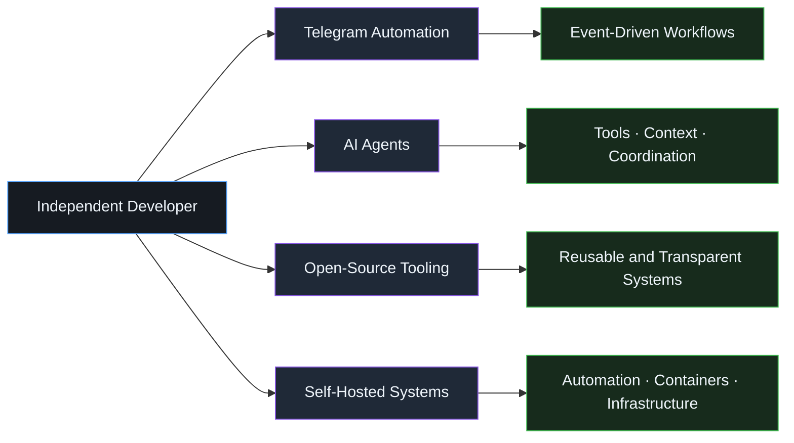

<!--
  Profile README — walid-zd213
  English version
  Keep this file structurally aligned with README_AR.md
-->

# Walid · Independent Developer

### Telegram Automation · AI Agents · Open-Source Systems

  

  
  
  
  

---

## About

I am an independent developer and technical researcher focused on building intelligent, practical, and open systems.

My work revolves around automation, agent-based software, self-hosted infrastructure, and open-source experimentation.

I am interested in turning complex ideas into reliable tools, reusable workflows, and understandable technical systems.

---

## Core Focus

<table>
<tr>
<td width="33%" valign="top">

### Telegram Automation

Designing intelligent Telegram bots and automation workflows with a focus on:

- Event-driven interactions
- Command and workflow systems
- Reliable background processes
- Practical user experiences
- Extensible bot architectures

</td>
<td width="33%" valign="top">

### AI Agents

Exploring interactive AI systems and agent-oriented architectures, including:

- Tool-using agents
- Multi-agent coordination
- Context-aware workflows
- Retrieval-augmented systems
- Human–AI interaction patterns

</td>
<td width="33%" valign="top">

### Open Systems

Building and studying transparent, adaptable, and self-hosted technologies through:

- Open-source tooling
- Self-hosted environments
- Containerized systems
- Automation infrastructure
- Reproducible workflows

</td>
</tr>
</table>

---

## Technical Direction

---

---

## GitHub Stats & Top Languages

  
  

