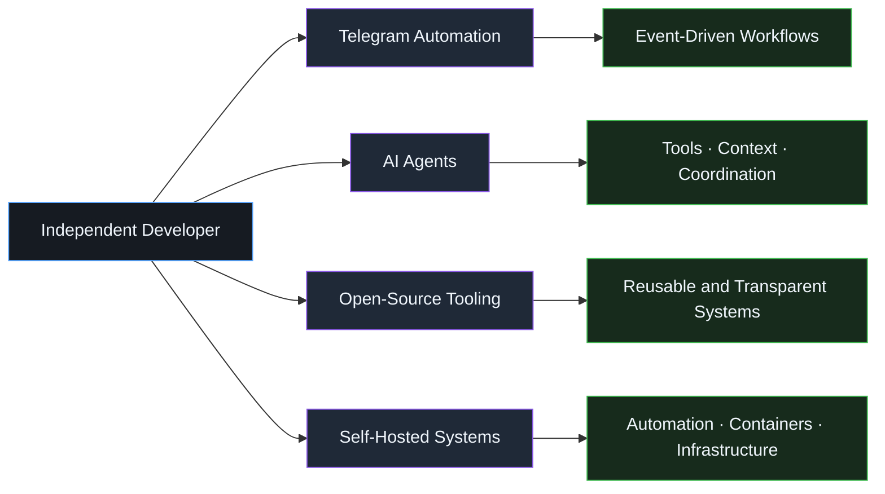

<!--
  Profile README — walid-zd213
  English version
  Keep this file structurally aligned with README_AR.md
-->

# Walid · Independent Developer

### Telegram Automation · AI Agents · Open-Source Systems

  

  
  
  
  

---

## About

I am an independent developer and technical researcher focused on building intelligent, practical, and open systems.

My work revolves around automation, agent-based software, self-hosted infrastructure, and open-source experimentation.

I am interested in turning complex ideas into reliable tools, reusable workflows, and understandable technical systems.

---

## Core Focus

<table>
<tr>
<td width="33%" valign="top">

### Telegram Automation

Designing intelligent Telegram bots and automation workflows with a focus on:

- Event-driven interactions
- Command and workflow systems
- Reliable background processes
- Practical user experiences
- Extensible bot architectures

</td>
<td width="33%" valign="top">

### AI Agents

Exploring interactive AI systems and agent-oriented architectures, including:

- Tool-using agents
- Multi-agent coordination
- Context-aware workflows
- Retrieval-augmented systems
- Human–AI interaction patterns

</td>
<td width="33%" valign="top">

### Open Systems

Building and studying transparent, adaptable, and self-hosted technologies through:

- Open-source tooling
- Self-hosted environments
- Containerized systems
- Automation infrastructure
- Reproducible workflows

</td>
</tr>
</table>

---

## Technical Direction

---

## Technology Landscape

### Languages & Application Development

- Python
- TypeScript
- JavaScript
- API and event-driven application design

### Automation & Intelligent Systems

- Telegram Bot APIs
- Workflow automation
- LLM-powered interactions
- Agent tools and orchestration
- Retrieval and context management

### Infrastructure & Self-Hosting

- Docker
- Linux-based environments
- Self-hosted services
- Databases and API-backed systems
- Cloud and local deployment workflows

### Engineering Practices

- Modular architecture
- Clear interfaces
- Reproducible environments
- Secure configuration management
- Documentation-first development

---

## Research & Exploration

The areas I continue to study and experiment with include:

- Multi-agent system design
- Agent memory and context handling
- Reliable tool calling
- Human-in-the-loop workflows
- Telegram-native AI experiences
- Lightweight self-hosted platforms
- Open-source system simplification
- Automation reliability and observability

---

## Engineering Principles

> Build useful systems. 
> Keep them understandable. 
> Prefer composable components. 
> Automate responsibly. 
> Share knowledge openly.

My approach is guided by:

- **Practicality over unnecessary complexity**
- **Transparency over black-box behavior**
- **Modularity over tightly coupled systems**
- **Reliability over short-term prototypes**
- **Continuous research over static assumptions**

---

## Current Direction

I am currently refining my approach to:

- Build more capable Telegram automation systems.
- Explore dependable AI agent architectures.
- Design self-hosted workflows with fewer unnecessary dependencies.
- Transform experiments into reusable open-source knowledge.
- Document technical ideas clearly and responsibly.

---

## Collaboration

I am open to thoughtful collaboration around:

- Telegram automation
- AI agent systems
- Open-source tooling
- Self-hosted infrastructure
- Developer productivity
- Technical research and experimentation

The best collaborations begin with a clear problem, a useful idea, and a willingness to build in the open.

---

## Connect

  

Independent development · Open research · Practical automation

---

Built with curiosity, engineering discipline, and an open-source mindset.

