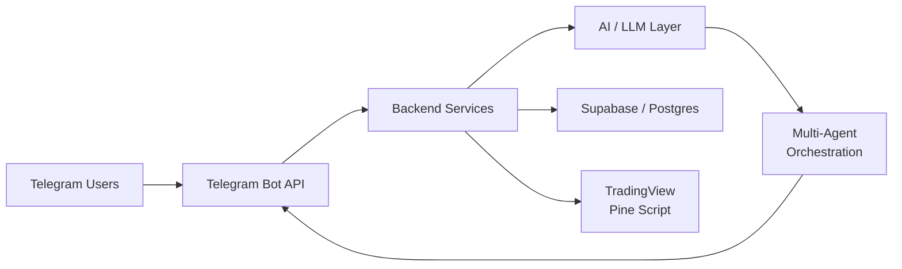

<!--
  ⚡ Special README — walid-zd213/walid-zd213
  Maintained by Mavis (Lead Repository Architect) for Walid.
  Custom widgets: readme-typing-svg · github-readme-stats · streak-stats
  Edit with care: the HTML comment blocks keep the layout intact.
-->

<div align="center">

  

  <br><br>

  
  
  

</div>

---

## 👋 About Me

> **Walid** — Software Developer building intelligent automation for Telegram, AI, and trading workflows.

🚀 Passionate about building intelligent Telegram bots, AI agents, and custom workflow automations.

🛠️ Currently focusing on Python, Node.js, Cloud deployments, and TradingView Pine Script indicators.

💡 Exploring multi-agent orchestration and automated personal tools.



---

## 🧰 Tech Stack

<div align="center">

| **Languages** | **Backend & AI** | **Data & Cloud** | **Tooling** |
|:---:|:---:|:---:|:---:|
|  |  |  |  |
|  |  |  |  |
|  |  |  |  |

</div>

---

## 📊 GitHub Stats & Activity

<div align="center">

  

  

</div>

<br>

<div align="center">

  

</div>

<br>

<div align="center">

  

</div>

---

## 🌱 What I'm Building

| Area | Details |
|:--|:--|
| 🤖 **Telegram Bots** | Long-running bot services, inline keyboards, session handling, rate-limit aware polling/webhooks |
| 🧠 **AI Integration** | LLM-powered assistants, RAG over Supabase, prompt pipelines, structured outputs |
| 🕸️ **Multi-Agent Systems** | Agent orchestration, tool routing, supervisor patterns, shared memory |
| 📈 **TradingView** | Pine Script v5 indicators, strategy automation, alert → webhook → bot pipelines |
| 🛠️ **Personal Automation** | Scheduled jobs, scrapers, notification pipelines, self-hosted tooling |

---

## 📌 Pinned Work

<div align="center">

  <a href="https://github.com/walid-zd213/walid-zd213">
    
  </a>

</div>

---

## 📬 Contact & Social

<div align="center">

  <a href="https://github.com/walid-zd213">
    
  </a>
  <a href="mailto:walid.zd213@gmail.com">
    
  </a>
  <!-- TODO(walid): confirm the Telegram handle below, then drop this comment. -->
  <a href="https://t.me/walid_zd213">
    
  </a>
  <a href="https://github.com/walid-zd213/walid-zd213/issues">
    
  </a>
  <a href="https://github.com/walid-zd213/walid-zd213/discussions">
    
  </a>

</div>

---

## 💬 Let's Build Something

Open to collaborations around **Telegram automation**, **AI agent systems**, and **trading tooling**.
If something here matches what you're building, open an issue or drop a message — replies are welcome.

```bash
# Clone the profile repo
git clone https://github.com/walid-zd213/walid-zd213.git
```

---

<div align="center">

  <sub>Built with ⚡ by Walid & Mavis — Last updated: <code>2026-10-22</code></sub>

</div>
