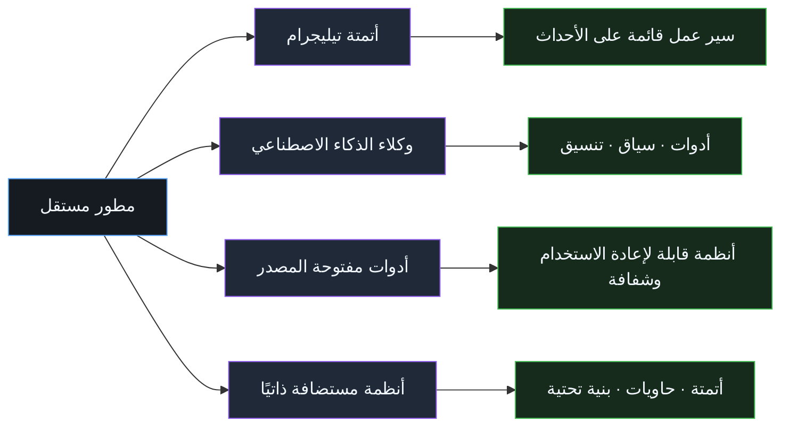

<!--
  Profile README — walid-zd213
  النسخة العربية
  حافظ على تطابق الهيكل مع README.md
-->

# وليد · مطوّر مستقل

### أتمتة تيليجرام · وكلاء الذكاء الاصطناعي · الأنظمة مفتوحة المصدر

  

  
  
  
  

---

## نبذة

أنا مطوّر مستقل وباحث تقني أركز على بناء أنظمة ذكية وعملية ومفتوحة.

يدور اهتمامي حول الأتمتة، والبرمجيات القائمة على الوكلاء، والبنية ذاتية الاستضافة، والتجارب المفتوحة المصدر.

أهتم بتحويل الأفكار المعقدة إلى أدوات موثوقة، وسير عمل قابلة لإعادة الاستخدام، وأنظمة تقنية سهلة الفهم.

---

## مجالات التركيز

<table>
<tr>
<td width="33%" valign="top">

### أتمتة تيليجرام

تصميم بوتات تيليجرام وسير عمل مؤتمتة مع التركيز على:

- التفاعلات القائمة على الأحداث
- أنظمة الأوامر وسير العمل
- العمليات الخلفية الموثوقة
- تجارب الاستخدام العملية
- البنى القابلة للتوسع

</td>
<td width="33%" valign="top">

### وكلاء الذكاء الاصطناعي

استكشاف الأنظمة التفاعلية والبنى القائمة على الوكلاء، بما في ذلك:

- الوكلاء القادرون على استخدام الأدوات
- تنسيق الوكلاء المتعددين
- سير العمل المدرك للسياق
- أنظمة الاسترجاع المعزز
- أنماط التفاعل بين الإنسان والذكاء الاصطناعي

</td>
<td width="33%" valign="top">

### الأنظمة المفتوحة

بناء ودراسة تقنيات شفافة وقابلة للتكيف وقابلة للاستضافة الذاتية من خلال:

- أدوات المصادر المفتوحة
- البيئات المستضافة ذاتيًا
- الأنظمة المعتمدة على الحاويات
- بنية الأتمتة
- سير العمل القابلة لإعادة الإنتاج

</td>
</tr>
</table>

---

## الاتجاه التقني

---

## المشهد التقني

### اللغات وتطوير التطبيقات

- Python
- TypeScript
- JavaScript
- تصميم التطبيقات القائمة على الواجهات والأحداث

### الأتمتة والأنظمة الذكية

- Telegram Bot APIs
- أتمتة سير العمل
- التفاعلات المدعومة بنماذج اللغة
- أدوات الوكلاء وتنسيقها
- الاسترجاع وإدارة السياق

### البنية التحتية والاستضافة الذاتية

- Docker
- بيئات Linux
- الخدمات المستضافة ذاتيًا
- قواعد البيانات والأنظمة المعتمدة على الواجهات
- سير عمل النشر السحابي والمحلي

### ممارسات هندسة البرمجيات

- البنى المعيارية
- الواجهات الواضحة
- البيئات القابلة لإعادة الإنتاج
- الإدارة الآمنة للإعدادات
- التطوير الذي يبدأ بالتوثيق

---

## البحث والاستكشاف

أواصل دراسة وتجربة المجالات التالية:

- تصميم أنظمة الوكلاء المتعددين
- ذاكرة الوكلاء وإدارة السياق
- استدعاء الأدوات بطريقة موثوقة
- سير العمل التي يشارك فيها الإنسان
- تجارب الذكاء الاصطناعي الموجهة لتيليجرام
- المنصات الخفيفة المستضافة ذاتيًا
- تبسيط الأنظمة مفتوحة المصدر
- موثوقية الأتمتة وقابليتها للمراقبة

---

## مبادئ هندسية

> ابنِ أنظمة مفيدة. 
> حافظ على قابليتها للفهم. 
> فضّل المكونات القابلة للتركيب. 
> أتمت بمسؤولية. 
> شارك المعرفة بانفتاح.

يعتمد أسلوبي على:

- **العملية بدل التعقيد غير الضروري**
- **الشفافية بدل السلوك الغامض**
- **المرونة المعيارية بدل الترابط الشديد**
- **الموثوقية بدل النماذج الأولية المؤقتة**
- **البحث المستمر بدل الافتراضات الجامدة**

---

## الاتجاه الحالي

أعمل حاليًا على تطوير منهجي في المجالات التالية:

- بناء أنظمة أتمتة أكثر قدرة عبر تيليجرام.
- استكشاف بُنى موثوقة لوكلاء الذكاء الاصطناعي.
- تصميم سير عمل مستضافة ذاتيًا بأقل قدر من الاعتماديات غير الضرورية.
- تحويل التجارب إلى معرفة مفتوحة قابلة لإعادة الاستخدام.
- توثيق الأفكار التقنية بوضوح ومسؤولية.

---

## التعاون

أرحب بالتعاون الجاد في المجالات التالية:

- أتمتة تيليجرام
- أنظمة وكلاء الذكاء الاصطناعي
- الأدوات مفتوحة المصدر
- البنية التحتية المستضافة ذاتيًا
- إنتاجية المطورين
- البحث والتجريب التقني

أفضل الشراكات تبدأ بمشكلة واضحة، وفكرة مفيدة، واستعداد للبناء بشفافية.

---

## التواصل

  

تطوير مستقل · بحث مفتوح · أتمتة عملية

---

صُنع بدافع الفضول والانضباط الهندسي وروح المصادر المفتوحة.

