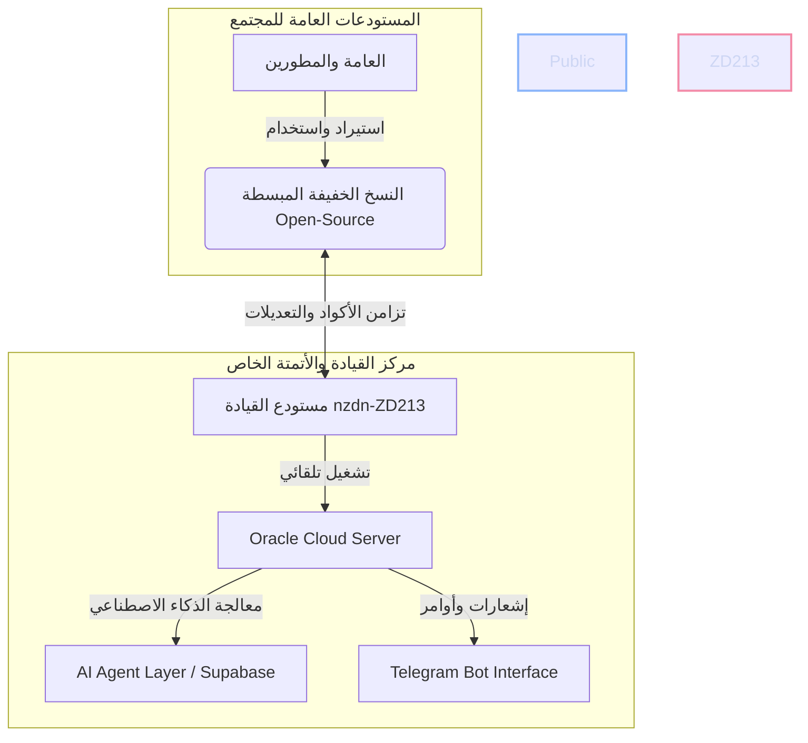

<!--
  ⚡ Special README (AR) — walid-zd213/walid-zd213
  Maintained by Mavis (Lead Repository Architect) for Walid.
  النسخة الإنجليزية: README.md — حدّث الملفين معاً عند أي تعديل.
-->

<div align="center">

  <a href="README.md">
    
  </a>

  <br><br>

  

  <br><br>

  
  
  <br>
  
  
  

</div>

---

## 👋 نبذة عني

> **وليد** — مطوّر برمجيات أبني أتمتة ذكية لتيليجرام ووكلاء الذكاء الاصطناعي وأدوات مفتوحة المصدر للمجتمع.

🚀 شغوف ببناء بوتات تيليجرام ذكية، ووكلاء ذكاء اصطناعي، وأتمتة مخصصة لسير العمل.

🛠️ أركّز حالياً على Python وNode.js والبيئات السحابية ذاتية الاستضافة وأدوات مفتوحة المصدر.

💡 أستكشف تنسيق الوكلاء المتعددين، والأنظمة الشخصية الآلية، والنسخ مفتوحة المصدر المبسّطة.



---

## 🧰 التقنيات المستخدمة

<div align="center">

| **اللغات** | **الخلفية والذكاء الاصطناعي** | **البيانات والسحابة** | **الأدوات** |
|:---:|:---:|:---:|:---:|
|  |  |  |  |
|  |  |  |  |
|  |  |  |  |

</div>

---

## 📊 إحصائيات GitHub والنشاط

<div align="center">

  

  

</div>

<br>

<div align="center">

  

</div>

<br>

<div align="center">

  

</div>

---

## 🌱 ماذا أبني

| المجال | التفاصيل |
|:--|:--|
| 🤖 **أتمتة تيليجرام** | خدمات بوتات طويلة التشغيل، معالجات أوامر مخصصة، تحديد معدل الطلبات وويبهوك. |
| 🧠 **أنظمة الذكاء الاصطناعي والوكلاء** | تنسيق متعدد الوكلاء، خطوط RAG، توجيه أدوات LLM. |
| 📦 **تحسين مفتوح المصدر** | نسخ المرايا، تدقيقها، وتبسيط المستودعات المعقّدة (مثل n8n) إلى نسخ خفيفة صديقة للمجتمع. |
| ⚙️ **الأنظمة الشخصية والسحابية** | أدوات ذاتية الاستضافة، بيئات Docker، وسير عمل سحابية على Oracle Cloud. |

---

## 📌 أعمال مختارة

<div align="center">

  <a href="https://github.com/walid-zd213/walid-zd213">
    
  </a>

</div>

---

## 📬 التواصل والروابط

<div align="center">

  <a href="https://github.com/walid-zd213">
    
  </a>
  <a href="mailto:walid.zd213@gmail.com">
    
  </a>
  <!-- TODO(walid): confirm the Telegram handle below, then drop this comment. -->
  <a href="https://t.me/walid_zd213">
    
  </a>
  <a href="https://github.com/walid-zd213/walid-zd213/issues">
    
  </a>
  <a href="https://github.com/walid-zd213/walid-zd213/discussions">
    
  </a>

</div>

---

## 💬 لنبنِ شيئاً معاً

مفتوح للتعاون في **أتمتة تيليجرام** و**أنظمة وكلاء الذكاء الاصطناعي** و**أدوات مفتوحة المصدر**.
إذا كان ما تبحث عنه موجود هنا، افتح issue أو راسلني — الردود مرحّب بها.

```bash
# استنسخ مستودع الملف الشخصي
git clone https://github.com/walid-zd213/walid-zd213.git
```

---

<div align="center">

  <sub>صُنع بـ ⚡ بواسطة وليد & Mavis — آخر تحديث: <code>2026-10-23</code></sub>

</div>
